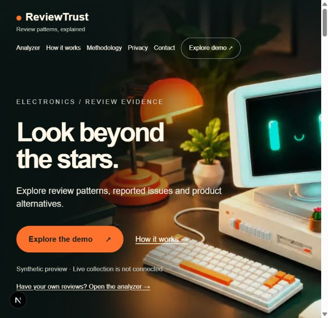
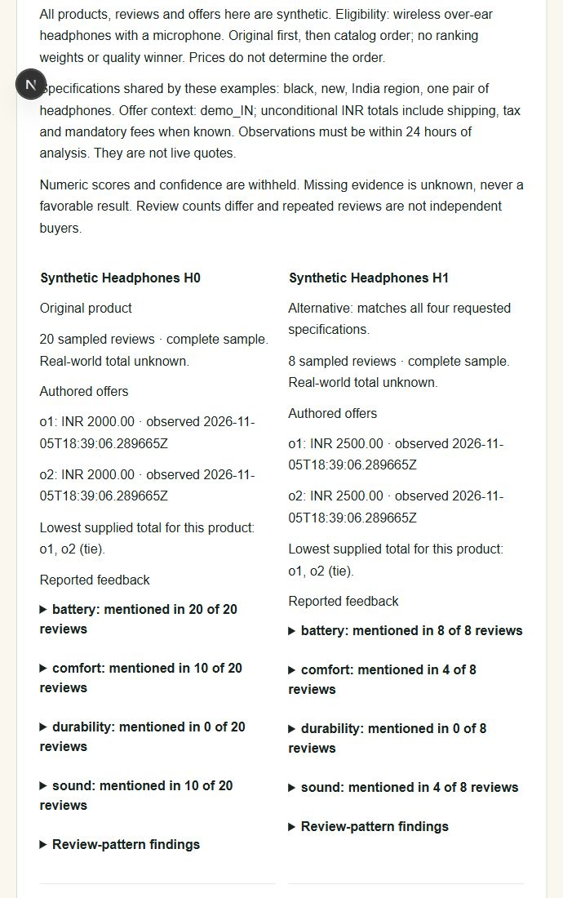
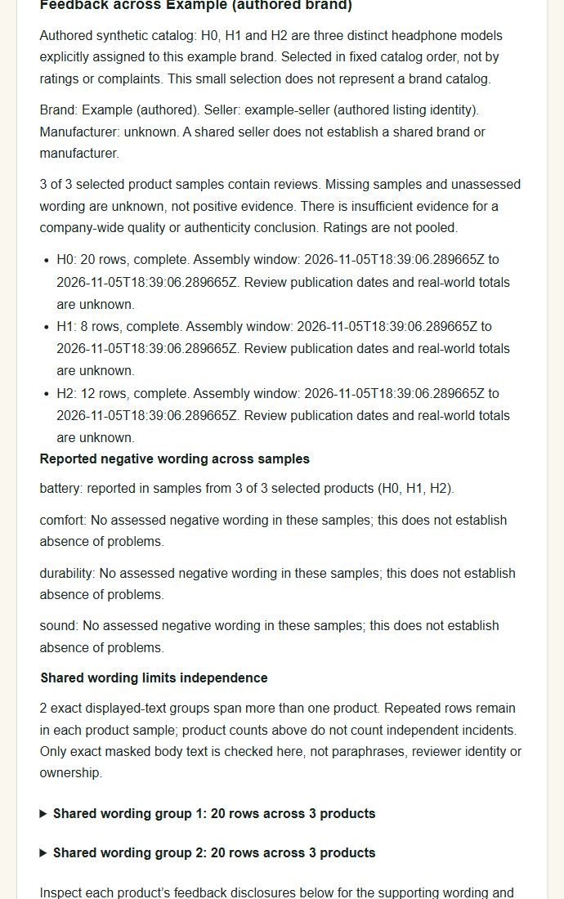

# ReviewTrust

**Look beyond the stars.** Explore electronics review patterns, reported product feedback and alternative-product comparisons with supporting evidence.


> Local development preview. Product comparisons and brand examples use authored synthetic data. Live product-link collection is not connected. Numeric scores and confidence are withheld; findings do not establish authenticity or product quality.

[Quick start](#quick-start) · [Screenshots](#screenshots) · [Project status](#project-status) · [Documentation](#documentation)

## What you can try

| Feature | Current behavior |
| --- | --- |
| Review-pattern analysis | Analyze submitted English electronics reviews through paste or CSV; inspect repetition, incentive mentions and contextual findings with coverage and excerpts. |
| Product feedback | Explore battery, comfort, durability and sound mentions in authored headphone samples, with counts and supporting wording. |
| Alternatives and offers | Compare authored products, dated INR offers, complete/partial/empty samples, unknown costs and ties. |
| Brand feedback | Inspect themes across three explicitly identified synthetic models, with per-product coverage and shared-text disclosures. |
| Interactive homepage | Full-bleed Spline computer scene with Pause/Resume 3D. The scene unloads outside the hero or when the document is hidden; returning reloads it. |

Missing evidence remains unknown. No real dataset, trained classifier, validated accuracy or calibrated confidence is available. Automatic masking is incomplete: remove personal information before submitting reviews.

## Screenshots

Captured from the local application on 2026-11-06. Results shown below are synthetic, not live retailer data; displayed timestamps and prices are demonstration values.

### Homepage



The hero artwork above is the local fallback illustration. The interactive scene can differ in camera, lighting and decoration; its published asset is maintained outside Git. [Scene isolation, attribution and performance notes](docs/SPLINE_HERO.md).

### Authored product comparison



### Authored brand feedback



See [screenshot provenance](docs/images/README.md) for capture details and 3D attribution.

## Quick start

Prerequisites: **Node.js 24**, **Python 3.12** and Git. Run these commands from the repository root in PowerShell:

```powershell
python -m venv api/.venv
& ./api/.venv/Scripts/python.exe -m pip install -r api/requirements-dev.txt
npm --prefix web ci
```

Start the API and website in separate terminals:

```powershell
# Terminal 1 — API on http://127.0.0.1:8000
./scripts/dev-api.ps1
```

```powershell
# Terminal 2 — website on http://127.0.0.1:3000
npm --prefix web run dev
```

Open [the homepage](http://127.0.0.1:3000/). At `/#demo`, select a review, comparison or brand example and click **Analyze synthetic example**. At `/#analyze`, submit your own permitted, minimized review subset. Both servers must be running for analysis results.

On macOS/Linux:

```sh
python3.12 -m venv api/.venv
api/.venv/bin/python -m pip install -r api/requirements-dev.txt
npm --prefix web ci
# In a separate terminal, from api/:
.venv/bin/python -m uvicorn app.main:app --host 127.0.0.1 --port 8000 --reload --no-access-log --no-proxy-headers
# From the repository root:
npm --prefix web run dev
```

No provider API key is required for the current synthetic demo. Browser API configuration defaults to `http://127.0.0.1:8000`; set `NEXT_PUBLIC_API_URL` in `web/.env.local` only to a trusted API origin, then restart/rebuild. This variable is public: never put a secret in it. API settings do not automatically load `.env` files. See [API configuration](docs/API.md) and [frontend configuration](docs/FRONTEND.md).

## Architecture

| Location | Responsibility |
| --- | --- |
| `web/` | Next.js App Router, React, TypeScript and Tailwind; validated API responses, escaped evidence, request cancellation and synthetic comparison/brand views. |
| `api/app/` | FastAPI/Pydantic validation, bounded ingestion and analysis, source contracts and authored comparison modules. |
| `ml/` | Offline source audit, frozen synthetic splits, heuristic mechanics evaluation and resource benchmarks; no training pipeline is authorized. |
| `scripts/` | Loopback development commands and verification workflow. |
| `docs/` | Contracts, source gates, methodology, threat model, measurements and handoffs. |

The browser calls the configured API directly. Uploads/results remain in application memory, with no saved history or database. Decorative 3D runs in an opaque sandbox without review-data access; loading it makes external Spline-related requests. [Privacy](docs/CONTENT.md) · [3D integration](docs/SPLINE_HERO.md).

Key endpoints:

| Endpoint | Behavior |
| --- | --- |
| `GET /health` | Development health check. |
| `POST /v1/analyze` | Submitted JSON review analysis. |
| `POST /v1/analyze/csv` | Bounded multipart CSV ingestion. |
| `POST /v2/demo/analyze` | Fixed authored review/comparison/brand examples. |
| `POST /v2/products/analyze` | Validates product requests and fails closed; live collection is unavailable. |

## Project status

- [x] Steps 1–12: application foundation, evidence presentation, offline audits and local security preparation.
- [x] E03/E04/E06: source contracts, offline parser and authored sample assembly.
- [x] E07/E08 synthetic demo, E09 synthetic feedback, E11–E15 authored identity/candidate/offer/comparison/brand functionality.
- [x] E16–E18: NO TRAIN, training skipped with reason, NO MODEL integration decision.
- [x] Homepage redesign and automatic Spline hero with visibility controls.
- [ ] E02/E05: permitted source access and complete live network/collection verification.
- [ ] E07–E15 real-source integration and representative evaluation.
- [ ] E19: real product-link release acceptance; existing synthetic verification does not satisfy it.
- [ ] Original Step 13 / E20: deployment and production verification, deferred by the owner.

The owner reports Bright Data login/API-key visibility. Amazon.in entitlement, permitted uses, actual fields, quotas, budget and an allowed probe remain unverified. The current conditional pilot is Amazon.in product discovery plus bounded review retrieval; cross-site support is not available. [Source pilot](docs/INDIA_SOURCE_PILOT.md) · [Full tracker](docs/PRODUCT_ROADMAP.md).

Public numeric scores remain withheld under methodology `rt-patterns-0.3.0-experimental`. Contact is intentionally blank in `web/lib/contact.ts`; a monitored destination and provider/release gates must be resolved before public launch. [Model decision](docs/MODEL_CARD.md) · [Deployment preparation](docs/DEPLOYMENT.md).

## Verification

Run the full local workflow from the repository root:

```powershell
./scripts/check.ps1
```

It covers dependency consistency, backend/offline tests, Ruff, frontend tests, ESLint, TypeScript and the production build. For frontend-only work:

```powershell
npm --prefix web run test
npm --prefix web run lint
npm --prefix web run typecheck
npm --prefix web run build
```

See [offline verification commands](ml/README.md), [local verification evidence](docs/LOCAL_VERIFICATION.md) and [benchmark limitations](docs/BENCHMARK.md). Synthetic checks verify software behavior, not detection accuracy. Recorded checks are historical observations; configured GitHub Actions does not establish that remote CI passed for a new commit.

## Documentation

- [Specification and methodology](SPEC.md) · [API](docs/API.md) · [Input validation](docs/INPUT_VALIDATION.md)
- [Synthetic demo](docs/SYNTHETIC_DEMO.md) · [Feedback](docs/PRODUCT_FEEDBACK.md) · [Comparisons](docs/PRODUCT_COMPARISON.md) · [Brand view](docs/BRAND_FEEDBACK.md)
- [Threat model](docs/THREAT_MODEL.md) · [Security audit](docs/SECURITY_AUDIT.md) · [Decisions](docs/DECISIONS.md)
- [Dataset audit](docs/DATASET_AUDIT.md) · [Offline workflow](ml/README.md) · [Model card](docs/MODEL_CARD.md)
- [Engineering guidance](AGENTS.md) · [Handoff](docs/HANDOFF.md) · [Expansion roadmap](docs/PRODUCT_ROADMAP.md)

Commits and pushes are performed manually by the owner. Keep credentials, real review datasets, local environments and generated build output out of Git.
