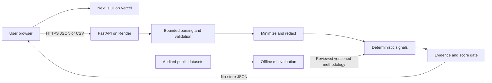

# ReviewTrust specification

Status: Steps 1–2 complete; Step 3 canonical schemas and in-memory JSON/CSV validation implemented. Analysis features remain unimplemented. Date: 2026-10-27.
Methodology proposal: `rt-patterns-0.1-draft`. All numerical thresholds below are engineering hypotheses, not empirically validated authenticity thresholds.

## 1. Product and boundaries

ReviewTrust analyzes observable patterns in user-supplied electronics reviews. It is not an authenticity authority. A Trust Score describes fewer or more concerning patterns under a named methodology; it is not the probability that reviews are genuine, a product-quality score, or a purchasing recommendation.

V1 includes a public website, pasted reviews, CSV input, explainable analysis and a responsive results dashboard. No account, database, paid LLM, third-party URL fetching, browser extension, stored analysis history or sharing links. Public research datasets are offline evaluation inputs only after a provenance and permission audit.

Initial assumptions: English-language text; one product per submission; user confirms electronics category and language. These declarations are unverified. Other languages and mixed-product inputs are unsupported. No automatic language classifier is needed initially; explain that misdeclared input can invalidate findings.

## 2. Architecture and data flow

Browser calls the API directly; Next.js serves presentation, not a second analysis proxy. Restrictive CORS is required but is not authentication or an abuse barrier. FastAPI is the authoritative parser, validator and scoring implementation. Browser checks are convenience only. Analysis runs synchronously with bounded work. Start with a single API process and bounded concurrency; multi-instance operation requires a verified shared edge limit before launch at that scale.

Planned layout: `web/` Next.js App Router, React, TypeScript, Tailwind; `api/` FastAPI, Pydantic, Uvicorn and pure analysis functions; `ml/` offline audits/evaluation; `docs/` decisions, threats and handoff. Use Python standard-library CSV parsing. Add NumPy/scikit-learn for justified baselines; pandas for dataset work only when useful. Pin compatible dependencies in Step 2 and audit them again before deployment; no versions are selected here. Charts can start with accessible HTML/CSS distributions.

Raw input exists only in browser memory and bounded API request memory. No localStorage, server persistence, analytics payload capture, file spooling or crash payload dumps. Returning results does not create retrievable server state. Reset clears application state; ordinary runtime memory release is not a secure-erasure guarantee. Hosting access logs and their retention require production verification.

## 3. Input contract and limits

Versioned request envelope: `schema_version: "1"`, `category: "electronics"`, `language: "en"`, `origin: "paste" | "csv"`, `reviews`. Research origin is assigned only by the offline evaluation adapter, never trusted from public clients. All origins are unverified subsets; source declarations do not prove representativeness.

Canonical review fields:

| Field | Contract |
| --- | --- |
| text | Required nonblank string, 1–5,000 Unicode code points after trim |
| rating | Optional finite number 1–5 inclusive; boolean rejected; no implicit rescaling |
| timestamp | Optional ISO date or timezone-aware datetime; dates retain day precision, datetimes normalize to UTC; reject future dates relative to request UTC date |
| product_id | Optional opaque string, 1–100 characters; at most one distinct nonempty value per request |
| title | Optional string up to 300 characters |
| verified_purchase | Optional strict boolean; source-reported, never proof of authenticity |
| source_id | Optional opaque source label up to 100 characters, never a fetched URL |

Missing optional values become null, not zero/false. Malformed supplied metadata rejects the request rather than silently becoming missing. Unknown JSON fields are rejected. Assign request-local references `r1`, `r2`, etc. in input order; never accept reviewer names or persistent reviewer IDs. Product/source identifiers are treated as potentially sensitive and omitted from logs. Mixed known/unknown product IDs carry a grouping limitation. Titles are displayed but excluded from v0.1 text signals to avoid double counting.

Step 3 contract details: trim text, title and identifiers; reject NUL and unpaired surrogate characters. JSON does not coerce numeric strings, booleans into ratings or integers/strings into verified-purchase flags. Accept timestamps as `YYYY-MM-DD` or `YYYY-MM-DDTHH:MM:SS[.ffffff](Z|±HH:MM)` with a valid offset; datetime precision is at most six fractional digits. Future-date checks use the UTC date captured once per submission, comparing normalized datetimes by their UTC date (not by the time of day). Ratings are checked before binary-float rounding; canonical rating values are floats. JSON duplicate keys, nonstandard NaN/Infinity constants, malformed UTF-8 and unparseable numeric representations are rejected. JSON submissions require paste origin; CSV origin is set by the parser.

Proposed server ceilings: 1 MiB total request body (1,048,576 bytes including multipart overhead), 500 rows, 250,000 aggregate text/title code points, 5,000 code points per review. Reject empty input. Enforce bytes while streaming, including absent or false Content-Length; reject compressed request bodies and archives. Limit concurrency initially to two analyses, a bounded execution budget of 10 seconds, and no unbounded queue. A timeout response alone must not leave CPU work running: implement cooperative deadline checks or bounded cancellable work. Tune limits only with measurements in Step 10.

CSV: one UTF-8 file with optional BOM; comma delimiter, standard quoting and quoted newlines. Header required, duplicate headers, ragged rows, invalid encoding, NUL bytes and malformed quotes rejected. A header-only browser preview lets users map columns explicitly; send a bounded mapping object with the file. A canonical `text` column needs no manual mapping. Reject ambiguous mappings and multiple columns mapped to one field. Unmapped columns (including names) are discarded immediately, with a warning listing column positions, not values. CSV optional empty cells map to null; rating parses finite decimal; booleans accept only `true`/`false`; dates follow the canonical contract. No silent row dropping or truncation. Error row numbers count logical CSV records, not physical lines. Standard library parsing avoids spreadsheet formula evaluation. Export is deferred; formula neutralization is mandatory if introduced.

Implemented CSV details: at most 50 columns, trimmed nonempty case-sensitive headers of at most 100 code points, and at most 5,000 code points per raw cell, including ignored columns. A mapping is an object from source header to canonical field, e.g. `{"Opinion":"text","Stars":"rating"}`; it may contain at most seven entries, requires text, and replaces automatic mapping completely. Without a mapping, exact canonical headers are selected automatically. Unknown headers are ignored, not inferred. The first data record is CSV record 2; blank records reject rather than disappear. Optional cells are trimmed before conversion; scientific notation is not accepted for CSV ratings. Bare quotes inside unquoted cells are rejected in addition to standard-library strict parsing. Parser data is never written to disk. Formula-like text is retained as inert review content; there is no export or spreadsheet execution.

The in-memory parsers enforce a 1 MiB input byte limit. HTTP streaming limits, total multipart-envelope size, Content-Encoding checks, CORS, rate limits and public error responses are Step 4 integration work; using these functions alone does not enforce transport controls. Text may still contain personal data; redaction before analysis/output is also future analysis work. The CSV parser discards ignored columns from canonical records; the caller still owns its uploaded bytes until request cleanup.

Pasted input uses one review per editable entry, with optional bulk split on blank lines and a review-count preview before submit. Do not infer ratings, timestamps or reviewers from prose. Preserve submitted duplicates for pattern detection; report possible duplicate ingestion as an alternative explanation.

## 4. API proposal

| Endpoint | Request | Response |
| --- | --- | --- |
| GET /health | None | 200 minimal status; no configuration, secrets or version inventory |
| POST /v1/analyze | application/json canonical envelope, origin paste | 200 AnalysisResult |
| POST /v1/analyze/csv | multipart file + mapping + category/language/schema fields | Same AnalysisResult, origin csv |

Both analysis endpoints use the same canonical validation and analysis function. JSON origin must match its route. No URL import endpoint. No retrieval/delete endpoint because no result is stored.

`AnalysisResult`: schema_version, methodology_version, experimental=true, origin, scope="submitted_subset", review_count, score, coverage, confidence, findings, reviews (redacted text/title and local references only), limitations.

`score`: status=`experimental` or `insufficient_evidence`, value=integer 0–100 or null, reason_codes[], evaluated_signal_ids[]. Never encode a withheld score as zero. `confidence`: status=`not_validated`, level=null, explanation. No Low/Medium/High confidence until a separate validation protocol justifies it.

`coverage`: total reviews, per-field present/missing counts, per-signal eligible/evaluated counts, evaluated and unavailable signal IDs, source declaration, unverified-subset limitation. Display counts with denominators, not a single accuracy-like coverage percentage.

Each finding: signal_id, value (typed number/object or null), assessment=`observed` | `not_observed` | `unavailable`, explanation generated from the computed evidence, supporting_review_refs[], required_fields[], coverage={eligible,total}, availability_reason, methodology_version. Do not use legal/fraud labels or unsupported severity. Limit each finding to 20 supporting references with total matching count and `references_truncated`; evidence selection is deterministic by input order. All references must resolve to returned redacted reviews. No matching evidence means no invented excerpt.

Error envelope: `{error: {code, message, fields: [{row, field, code}], request_id}}`. Cap errors at 20 plus total count. Do not echo rejected values, raw input, parser traces or Pydantic input payloads. 400 malformed syntax, 413 size/row/text limits, 415 unsupported media/encoding, 422 semantic validation, 429 rate limit with Retry-After, 503 busy/deadline, 500 generic internal error. All analysis/error responses use Cache-Control: no-store. Cancellation/reset discards stale responses in UI.

Step 3 exposes `ReviewInputError` with `status_code`, safe `code`/message, at most 20 structured `fields` and `total_errors`; request IDs and HTTP serialization are added in Step 4. Invalid fields use canonical field names only; unknown submitted keys are replaced with `review`/`request`. JSON review rows are one-based; CSV rows include the header as record 1. Structural errors may fail fast without enumerating later records. No partial validated result is returned on failure.

## 5. Signals and experimental scoring

Preprocess redacted review text using Unicode NFKC, casefold and collapsed whitespace; preserve punctuation for exact matching. Record redaction counts. Matching on redaction placeholders is prohibited: exclude placeholder tokens from similarity and exclude rows that become blank. Conservative email/phone masking must precede excerpts and signal computation; this cannot guarantee detection of all personal data. Users must be warned before submit to remove personal information. No reviewer-network signal is justified in v1.

| Signal | Proposed computation and availability | Interpretation/limits |
| --- | --- | --- |
| text_repetition | At least 10 reviews with >=5 remaining word tokens. Fraction d of eligible rows having another exact normalized match or word TF-IDF (1–2 grams) cosine >=0.90. Fit within submission for descriptive similarity only; fixed tokenizer/version and 20,000 feature cap. Include qualifying pair references. | Templates, shared product descriptions and duplicate ingestion can explain repetition. Short reviews remain in total coverage but cannot support this signal. |
| review_burst | At least 20 dated rows, >=80% timestamp coverage and >=28-day observed span. Max count in any inclusive 3-calendar-day UTC window / dated count. Flag if >=0.50. Ties choose earliest window. | Launches/promotions and selected samples confound timing; unavailable for insufficient span. No claim about expected market review rate. |
| rating_distribution | At least 20 rated rows and >=80% rating coverage. Report exact-value histogram, mean, share <=2 and >=4; flag concentration if either share >=0.90. | Excellent or poor products can legitimately concentrate ratings. Descriptive only. |
| rating_text_disagreement | Step 6 versioned English lexicon baseline: >=20 rows with rating plus unambiguous supported text polarity; report eligible coverage. Flag row when rating <=2 with positive polarity or >=4 with negative polarity. Negated/mixed/unsupported wording abstains. | Sarcasm, aspect differences and lexicon errors; no supervised validity implied. Lexicon and negation rules must be specified/tested before availability, otherwise unavailable. |
| incentive_language | >=10 reviews with >=5 remaining word tokens. Fraction i matching a versioned phrase inventory such as “in exchange for a review” or “received this product for free”. Store exact matched spans; quoted/negated contexts are still described as mentions, not participation. | Disclosed incentives are not proof of manipulation; phrases alone cannot establish conduct. |

Step 4 may implement exact repetition and an explicit incentive phrase inventory, marking other signals `not_implemented`. Step 6 near-duplicate behavior requires a methodology version bump and boundary fixtures. Do not claim draft TF-IDF behavior is implemented earlier.

Only text_repetition and incentive_language contribute to the initial experimental index. Metadata-dependent and sentiment signals remain contextual until validation justifies inclusion. This fixed panel prevents missing timestamps/ratings from silently improving a score or correlated signals from stacking arbitrary penalties.

For eligible submissions: `penalty = max(d, i)`; `Trust Score = floor(100 * (1 - penalty) + 0.5)`. Fractions use their explicitly reported eligible denominators. Max aggregation deliberately avoids adding correlated evidence; it is a transparent conservative prototype, not learned weighting. No risk-band cutoffs are proposed. A value of 100 means neither included pattern was observed in eligible text, never verified authenticity. Scores are comparable only under the same methodology and similar input sampling/coverage.

Withhold the score if fewer than 20 submitted reviews, fewer than 20 eligible text rows, eligible text coverage <80%, either scoring signal unavailable, unsupported declared domain/language, or analysis incomplete. Invalid inputs return errors rather than partial scores. Withheld results may still show available findings. Lack of validation is always visible as `experimental`; public launch requires Step 10 evaluation and Step 12 review to decide whether a numeric score remains defensible. If it is not, ship findings/coverage with score withheld. Sample-size cutoffs are product safeguards, not statistical confidence guarantees.

Arithmetic examples (design checks, not benchmarks): d=0,i=0 =>100; d=.25,i=.10 =>75; d=.25,i=.40 =>60; d=1 =>0. Increasing either penalty holding the other fixed cannot increase the score. Removing ratings/timestamps cannot change the index; dropping required text coverage below the gate withholds it. Fewer findings on a selected sample is not evidence about all product reviews.

## 6. Dataset and validation gates

Step 7 records dataset origin, license/permissions, permitted redistribution/excerpts, electronics relevance, language, collection method, labels and their provenance, imbalance and missing fields. No dataset has been chosen or approved. Synthetic fixtures test mechanics only. Sentiment labels and platform filtering are not automatically deception ground truth.

Group products and duplicate/near-duplicate clusters across partitions before fitting; if clusters connect products, keep connected groups together. Freeze independent test IDs/hashes, seeds and manifests. Fit vocabularies and learned preprocessing on training data only for supervised evaluation; this differs from descriptive within-submission TF-IDF. Tune on validation data only. Document source/time shifts and domain limitations. No trustworthy target means no classifier training; complete Step 8 with a documented no-train decision and heuristic evaluation.

When labels justify classification, report computed precision, recall, F1, confusion matrix, support and threshold; evaluate calibration only on suitable independent probability predictions. Assess scoring robustness separately: sampling sensitivity, metadata removal, repetition, short/multilingual text, incentive negations, legitimate bursts, Unicode, prompt-like text and polarity disagreements. Step 10 records hardware, data hashes, versions, time/memory measurements and failure cases. Never invent performance or authenticity accuracy.

## 7. Acceptance criteria

Step 1: architecture and trust boundaries specified; contracts/limits/error handling defined; aggregation and withholding unambiguous; evidence distinct from confidence; threat controls and residual risks recorded; decisions, roadmap and handoff present; no application scaffolding created.

Step 2: `web/`, `api/`, `ml/` and `docs/` exist; dependencies and transitive resolutions are pinned; generated files/secrets/data are ignored; clean setup and start commands are documented; frontend component and backend API smoke tests, lint/type checks and frontend production build pass; both applications respond over local HTTP; CI contains equivalent checks; README is free of merge markers. Only a development placeholder page and API root status are implemented, without ingestion, scoring or analysis endpoints. Git staging/committing remains manual under the user's updated instruction.

Step 3: shared strict review/envelope schemas and JSON/CSV adapters enforce the specified bytes/rows/field/aggregate limits, date/rating/boolean semantics, one-product rule and optional null handling. CSV mapping, UTF-8/BOM, escaped/multiline quotes, malformed records and ignored-column warnings work. Duplicates and deterministic request-local references are preserved; errors are capped and contain no submitted values/unknown keys. Unit tests cover boundaries, invalid inputs, representation equivalence and regression cases. Existing app smoke tests and frontend checks remain passing. No new endpoints, scoring, database or dependencies.

MVP release gates:

1. Both apps start from documented clean setup; CI passes backend tests, frontend tests, lint, type checks and production build.
2. Paste and CSV complete end to end with equivalent canonical input producing equivalent findings; malformed optional data is never silently dropped.
3. Every signal has positive, negative, unavailable and boundary fixtures; reference IDs and computed explanations agree. Score gates, arithmetic, ordering stability and metadata-removal invariants pass.
4. UI handles empty, loading, error, rate-limited, insufficient and experimental states; reset clears state, keyboard navigation/focus/labels and 320px/mobile layout are checked; charts have text equivalents.
5. Requests above every limit, chunked bodies, malformed CSV/JSON, HTML/script strings and prompt-like content are tested server-side. Resource use is measured at maximum input and concurrent load; no uncontrolled timeout work remains.
6. No raw review/PII logging, persistent uploads, arbitrary outbound requests or secrets in source. CORS, no-store, HTTPS, abuse limits, proxy trust and host retention are verified in production. No unresolved critical security finding before deployment.
7. Methodology, limitations, privacy and a working contact/dispute channel are published. Contact destination must be supplied before Step 11 completion; no invented address.
8. Dataset/ML decisions and measured reports are reproducible. Confidence remains absent until validated. Public numeric scoring may be withheld if evaluation does not support it.

## 8. Design references

Upload boundary controls informed by [OWASP File Upload Cheat Sheet](https://cheatsheetseries.owasp.org/cheatsheets/File_Upload_Cheat_Sheet.html). Training-only preprocessing follows [scikit-learn common pitfalls](https://scikit-learn.org/stable/common_pitfalls.html). Consulted 2026-10-27. Neither source validates ReviewTrust's proposed scoring formula or thresholds.
