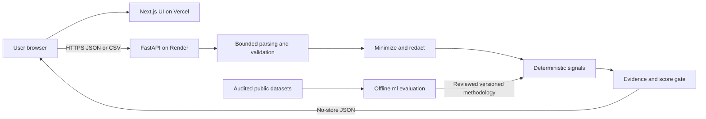

# ReviewTrust specification

Status: Steps 1–12 implemented through the interface, dataset audit, no-train evaluation, local synthetic benchmark and website content. No real dataset is admitted. Public numeric scores are not approved; enforce withholding before deployment. Contact is intentionally blank by user override. Local security audit/fixes are complete; owner/provider gates and deployment remain pending. Date: 2026-10-28.
Implemented methodology: `rt-patterns-0.3.0-experimental`, superseding `rt-patterns-0.2.0-experimental` for normalized-output limits and public score withholding. The underlying offline arithmetic/signals are unchanged. Repetition (exact or TF-IDF near match) and the incentive phrase list contribute; timing, ratings and lexicon disagreement remain contextual only. All numerical thresholds are engineering hypotheses, not empirically validated authenticity thresholds.

## 1. Product and boundaries

ReviewTrust analyzes observable patterns in user-supplied electronics reviews. It is not an authenticity authority. A Trust Score describes fewer or more concerning patterns under a named methodology; it is not the probability that reviews are genuine, a product-quality score, or a purchasing recommendation.

V1 includes a public website, pasted reviews, CSV input, explainable analysis and a responsive results dashboard. No account, database, paid LLM, third-party URL fetching, browser extension, stored analysis history or sharing links. Public research datasets are offline evaluation inputs only after a provenance and permission audit.

Initial assumptions: English-language text; one product per submission; user confirms electronics category and language. These declarations are unverified. Other languages and mixed-product inputs are unsupported. No automatic language classifier is needed initially; explain that misdeclared input can invalidate findings.

## 2. Architecture and data flow

Browser calls the API directly; Next.js serves presentation, not a second analysis proxy. Restrictive CORS is required but is not authentication or an abuse barrier. FastAPI is the authoritative parser, validator and scoring implementation. Browser checks are convenience only. Analysis runs synchronously with bounded work. Start with a single API process and bounded concurrency; multi-instance operation requires a verified shared edge limit before launch at that scale.

Layout: `web/` Next.js App Router, React, TypeScript, Tailwind; `api/` FastAPI, Pydantic, Uvicorn and pure analysis functions; `ml/` offline audits/evaluation; `docs/` decisions, threats and handoff. Use Python standard-library CSV parsing. Add NumPy/scikit-learn for justified baselines; pandas for dataset work only when useful. Compatible runtime/tool versions are pinned in package-lock.json and Python requirements; audit them again before deployment. Charts can start with accessible HTML/CSS distributions.

Raw input exists only in browser memory and bounded API request memory. No localStorage, server persistence, analytics payload capture, file spooling or crash payload dumps. Returning results does not create retrievable server state. Reset clears application state; ordinary runtime memory release is not a secure-erasure guarantee. Hosting access logs and their retention require production verification.

## 3. Input contract and limits

Versioned request envelope: `schema_version: "1"`, `category: "electronics"`, `language: "en"`, `origin: "paste" | "csv"`, `reviews`. Research origin is assigned only by the offline evaluation adapter, never trusted from public clients. All origins are unverified subsets; source declarations do not prove representativeness.

Canonical review fields:

| Field | Contract |
| --- | --- |
| text | Required nonblank string, 1–5,000 Unicode code points after trim |
| rating | Optional finite number 1–5 inclusive; boolean rejected; no implicit rescaling |
| timestamp | Optional ISO date or timezone-aware datetime; dates retain day precision, datetimes normalize to UTC; reject future dates relative to request UTC date |
| product_id | Optional opaque string, 1–100 characters; at most one distinct nonempty value per request |
| title | Optional string up to 300 characters |
| verified_purchase | Optional strict boolean; source-reported, never proof of authenticity |
| source_id | Optional opaque source label up to 100 characters, never a fetched URL |

Missing optional values become null, not zero/false. Malformed supplied metadata rejects the request rather than silently becoming missing. Unknown JSON fields are rejected. Assign request-local references `r1`, `r2`, etc. in input order; never accept reviewer names or persistent reviewer IDs. Product/source identifiers are treated as potentially sensitive and omitted from logs. Mixed known/unknown product IDs carry a grouping limitation. Titles are displayed but excluded from text signals to avoid double counting.

Step 3 contract details: trim text, title and identifiers; reject NUL and unpaired surrogate characters. JSON does not coerce numeric strings, booleans into ratings or integers/strings into verified-purchase flags. Accept timestamps as `YYYY-MM-DD` or `YYYY-MM-DDTHH:MM:SS[.ffffff](Z|±HH:MM)` with a valid offset; datetime precision is at most six fractional digits. Future-date checks use the UTC date captured once per submission, comparing normalized datetimes by their UTC date (not by the time of day). Ratings are checked before binary-float rounding; canonical rating values are floats. JSON duplicate keys, nonstandard NaN/Infinity constants, malformed UTF-8 and unparseable numeric representations are rejected. JSON submissions require paste origin; CSV origin is set by the parser.

Proposed server ceilings: 1 MiB total request body (1,048,576 bytes including multipart overhead), 500 rows, 250,000 aggregate text/title code points, 5,000 code points per review. Reject empty input. Enforce bytes while streaming, including absent or false Content-Length; reject compressed request bodies and archives. Limit concurrency initially to two analyses, a bounded execution budget of 10 seconds, and no unbounded queue. A timeout response alone must not leave CPU work running: implement cooperative deadline checks or bounded cancellable work. Tune limits only with measurements in Step 10.

CSV: one UTF-8 file with optional BOM; comma delimiter, standard quoting and quoted newlines. Header required, duplicate headers, ragged rows, invalid encoding, NUL bytes and malformed quotes rejected. A header-only browser preview lets users map columns explicitly; send a bounded mapping object with the file. A canonical `text` column needs no manual mapping. Reject ambiguous mappings and multiple columns mapped to one field. Unmapped columns (including names) are discarded immediately, with a warning listing column positions, not values. CSV optional empty cells map to null; rating parses finite decimal; booleans accept only `true`/`false`; dates follow the canonical contract. No silent row dropping or truncation. Error row numbers count logical CSV records, not physical lines. Standard library parsing avoids spreadsheet formula evaluation. Export is deferred; formula neutralization is mandatory if introduced.

Implemented CSV details: at most 50 columns, trimmed nonempty case-sensitive headers of at most 100 code points, and at most 5,000 code points per raw cell, including ignored columns. A mapping is an object from source header to canonical field, e.g. `{"Opinion":"text","Stars":"rating"}`; it may contain at most seven entries, requires text, and replaces automatic mapping completely. Without a mapping, exact canonical headers are selected automatically. Unknown headers are ignored, not inferred. The first data record is CSV record 2; blank records reject rather than disappear. Optional cells are trimmed before conversion; scientific notation is not accepted for CSV ratings. Bare quotes inside unquoted cells are rejected in addition to standard-library strict parsing. Parser data is never written to disk. Formula-like text is retained as inert review content; there is no export or spreadsheet execution.

The in-memory parsers enforce a 1 MiB input byte limit. Step 4 endpoints additionally count actual streamed HTTP bytes including multipart overhead, enforce content encoding, CORS, rate/admission/deadline controls and safe errors. Using library functions alone does not enforce transport controls. Common email/phone masking now precedes analysis/output; text may still contain names and other personal data, so full anonymization is not claimed. The CSV parser discards ignored columns from canonical records; request buffers remain in memory until request/worker cleanup.

Pasted input uses one review per editable entry, with optional bulk split on blank lines and a review-count preview before submit. Do not infer ratings, timestamps or reviewers from prose. Preserve submitted duplicates for pattern detection; report possible duplicate ingestion as an alternative explanation.

## 4. API proposal

| Endpoint | Request | Response |
| --- | --- | --- |
| GET /health | None | 200 minimal status; no configuration, secrets or version inventory |
| POST /v1/analyze | application/json canonical envelope, origin paste | 200 AnalysisResult |
| POST /v1/analyze/csv | multipart file + mapping + category/language/schema fields | Same AnalysisResult, origin csv |

Both analysis endpoints use the same canonical validation and analysis function. JSON origin must match its route. No URL import endpoint. No retrieval/delete endpoint because no result is stored.

Step 4 multipart: required file, schema_version/category/language text fields; optional mapping JSON object. At most five unique parts, 64 bytes per metadata field, 4,096 bytes for mapping, two supported headers per part with 8,192-byte header limit. Filename is ignored; bounded callback parsing never spools to disk. Exact media labels and environment configuration are documented in docs/API.md. GET / development status remains supported; trailing-slash redirects and interactive docs are disabled.

`AnalysisResult`: schema_version, methodology_version, experimental=true, origin, scope="submitted_subset", review_count, score, coverage, confidence, findings, reviews (redacted text/title and local references only), limitations.

Public `score`: status=`withheld` or `insufficient_evidence`, value=null, reason_codes[] always includes public_score_not_validated, evaluated_signal_ids[]. Only the offline library permits experimental integer values under its existing evidence gates. Never encode a withheld score as zero. `confidence`: status=`not_validated`, level=null, explanation. No Low/Medium/High confidence until a separate validation protocol justifies it.

`coverage`: total reviews, per-field present/missing counts, per-signal eligible/evaluated counts, evaluated and unavailable signal IDs, source declaration, unverified-subset limitation. Display counts with denominators, not a single accuracy-like coverage percentage.

Each finding: signal_id, value (typed number/object or null), assessment=`observed` | `not_observed` | `unavailable`, explanation generated from the computed evidence, supporting_review_refs[], required_fields[], coverage={eligible,total}, availability_reason, methodology_version. Do not use legal/fraud labels or unsupported severity. Limit each finding to 20 supporting references with total matching count and `references_truncated`; evidence selection is deterministic by input order. All references must resolve to returned redacted reviews. No matching evidence means no invented excerpt.

Error envelope: `{error: {code, message, fields: [{row, field, code}], request_id}}`. Cap errors at 20 plus total count. Do not echo rejected values, raw input, parser traces or Pydantic input payloads. 400 malformed syntax, 413 size/row/text limits, 415 unsupported media/encoding, 422 semantic validation, 429 rate limit with Retry-After, 503 busy/deadline, 500 generic internal error. All analysis/error responses use Cache-Control: no-store. Cancellation/reset discards stale responses in UI.

`ReviewInputError` exposes safe status/code/message, at most 20 structured fields and total_errors. Step 4 serializes it with a server-generated request_id matching X-Request-ID; unknown failures return generic 500 and log only error code/request ID. Invalid fields use canonical field names only; unknown submitted keys are replaced with review/request. JSON review rows are one-based; CSV rows include the header as record 1. Structural errors may fail fast without enumerating later records. No partial validated result or score is returned on failure. Disallowed declared origins return 403; unknown paths/methods return 404/405. CORS protocol preflights use Starlette's short-text format, while endpoint errors use the JSON envelope.

Server controls: token bucket capacity two/refill ten per minute by peer; idle hashed keys expire after 60 seconds, table capped at 10,000 with fail-closed admission. Random process-scoped HMAC key, no raw IP retained in limiter state. Default two admitted requests include body reads and workers; no unbounded work queue. Ten-second default body/processing deadline with cooperative checks; individual bounded parser calls are not preempted. Cancellation retains admission until worker completion. Native proxy forwarding is disabled by the development command; production must verify proxy/edge enforcement before changing topology. Limits are configurable within bounds in docs/API.md. This is a single-process control, not a distributed-abuse guarantee.

## 5. Signals and experimental scoring

Preprocess redacted review text using Unicode NFKC, casefold and collapsed whitespace; preserve punctuation for exact matching. Record redaction counts. Matching on redaction placeholders is prohibited: exclude placeholder tokens from similarity and exclude rows that become blank. Conservative email/phone masking must precede excerpts and signal computation; this cannot guarantee detection of all personal data. Users must be warned before submit to remove personal information. No reviewer-network signal is justified in v1.

| Signal | Implemented computation and availability | Interpretation/limits |
| --- | --- | --- |
| text_repetition | At least 10 reviews with >=5 remaining word tokens. Fraction d of eligible rows having another exact normalized match or word TF-IDF (1–2 grams) cosine >=0.90. Fit within submission for descriptive similarity only; fixed tokenizer/version and 20,000 feature cap. Include qualifying pair references. | Templates, shared product descriptions and duplicate ingestion can explain repetition. Short reviews remain in total coverage but cannot support this signal. |
| review_burst | At least 20 dated rows, >=80% timestamp coverage and >=28-day observed span. Max count in any inclusive 3-calendar-day UTC window / dated count. Flag if >=0.50. Ties choose earliest window. | Launches/promotions and selected samples confound timing; unavailable for insufficient span. No claim about expected market review rate. |
| rating_distribution | At least 20 rated rows and >=80% rating coverage. Report exact-value histogram, mean, share <=2 and >=4; flag concentration if either share >=0.90. | Excellent or poor products can legitimately concentrate ratings. Descriptive only. |
| rating_text_disagreement | Step 6 versioned English lexicon baseline: >=20 rows with rating plus unambiguous supported text polarity; report eligible coverage. Flag row when rating <=2 with positive polarity or >=4 with negative polarity. Negated/mixed/unsupported wording abstains. | Sarcasm, aspect differences and lexicon errors; no supervised validity implied. Lexicon and negation rules must be specified/tested before availability, otherwise unavailable. |
| incentive_language | >=10 reviews with >=5 remaining word tokens. Fraction i matching a versioned phrase inventory such as “in exchange for a review” or “received this product for free”. Store exact matched spans; quoted/negated contexts are still described as mentions, not participation. | Disclosed incentives are not proof of manipulation; phrases alone cannot establish conduct. |

### Methodology 0.2.0 details

Repetition: NFKC normalization and common email/phone masking precede all text signals. Remove masking placeholders, casefold and collapse whitespace. Exact matching preserves punctuation. Eligibility requires at least five Unicode letter/digit tokens (regex `[^\W_]+`, excluding underscores); titles never contribute. At least ten eligible reviews are required. Near matching uses these tokens as unigrams and adjacent bigrams, no stop words, stemming or sublinear term frequency. For each feature, raw count is multiplied by `1 + ln((1 + n)/(1 + document_frequency))`, where n is the number of eligible rows in this submission, including duplicates. L2-normalize each vector and compare sparse dot products. Exact normalized equality OR unrounded cosine >=0.90 qualifies a pair. Count each eligible row with any qualifying partner once. Similarity is descriptive within the submitted subset, never a fitted authenticity classifier or probability.

The vocabulary ceiling is 20,000 unigram/bigram features. Exceeding it makes repetition unavailable (`feature_limit`) and withholds the score; do not silently prune terms, since doing so can inflate similarity. Existing body/row/text limits bound construction; vocabulary is checked after each bounded row. Pair comparisons have cooperative deadline checks (at most 124,750 pairs for 500 rows), with no dense matrix or new dependency. Timeouts reject the request without a partial score. Feature-cap unavailability may still return other complete findings.

Pairs are visited in input-index order; retain the first ten qualifying pairs, with `match_kind` exact/tfidf and unrounded `similarity`. Exact pairs report 1.0. Supporting references are unique in first-evidence order; total matching count includes all qualifying rows, and `references_truncated` reports omitted matching references. The pair list is always only a bounded preview, even if all matching references fit. Word-order/punctuation changes, shared product descriptions and templates can qualify; different corpus composition can change IDF and near-match results. No equivalence of numerical values across methodology versions is claimed.

Incentives retain the four phrases from 0.1: "in exchange for a review", "received this product for free", "received a free product", "discount in exchange for". Use case-insensitive word boundaries and flexible whitespace on masked display text. At least ten five-token eligible rows are required. Each matching row counts once; retain the first real span per phrase, at most four spans per row and twenty evidence rows. Offsets index displayed Unicode code points with exclusive end. Quotations and negations remain mentions, never inferred participation.

Timing: use normalized UTC calendar days (date-only values retain their day). Require >=20 dated rows, >=80% dated coverage and `(latest_day - earliest_day).days >= 28`. Availability failures are checked in that order: `insufficient_dated_reviews`, `low_timestamp_coverage`, `insufficient_time_span`. Search windows beginning on each observed day and ending two calendar days later, inclusively; ties retain the earliest observed start day. Report maximum window count/dated count, start/end and observed span; mark observed if window count is >=50% of dated rows. Only an observed finding exposes supporting rows, in input order, with their UTC day. An available negative finding still reports its descriptive maximum window. Launches, promotions and selected samples can explain concentrations.

Ratings: require >=20 rated rows and >=80% rated coverage, otherwise `insufficient_rated_reviews` or `low_rating_coverage` in that order. Return an ascending exact-canonical-float-value histogram (no rounding into integer stars), arithmetic mean, share <=2 and share >=4. Mark observed if either extreme share is >=90%, using integer-count comparisons. Evidence includes the qualifying extreme rows and their submitted rating. Middle values, including decimals, remain in the denominator. Genuine quality and sample selection can explain concentrated ratings.

Rating/text disagreement uses `rt-en-polarity-0.1`. Positive words: good, great, excellent, superb, amazing, perfect. Negative words: bad, poor, terrible, awful, broken, useless. NFKC-masked body text only; placeholders are replaced by equal-length spaces to preserve offsets. Tokenize Unicode letter/digit words, allowing an internal straight/curly apostrophe. No stemming or implicit synonym inference. A row has supported polarity only if at least one word from exactly one direction is present and no abstention rule matches. Whole-row abstention triggers: no, not, never, nor, neither, without, hardly, barely, scarcely, cannot, unless, if, wish, but, however, although, though; any token ending in n't or n’t; any double/curly quote, question mark, standalone straight single quote; `/s` anywhere or the literal casefolded phrase `yeah right`. These deliberately conservative rules do not exhaust negation, quotation or sarcasm. Rows without a listed cue abstain, never count as agreement. Other non-cue words do not independently veto a supported direction; the declared abstention rules do.

Disagreement requires >=20 rows with a rating and supported polarity; otherwise `insufficient_supported_polarity`. It has no extra 80% gate, so show eligible/total coverage explicitly. Five-token text eligibility belongs to the scoring panel and does not silently constrain this contextual method. Rating <=2 with positive polarity, or >=4 with negative polarity, counts as disagreement; middle ratings count as eligible but not disagreements. Mark observed when at least one eligible row disagrees; report count/eligible fraction. Evidence carries rating, direction and the first four real lexicon cue spans. Retain at most twenty rows in input order. Sarcasm, aspects, multilingual wording and lexicon omissions remain unvalidated failure modes. Never infer model confidence from agreement.

Contextual values extend the response: burst value adds window_start/window_end/observed_span_days to FractionEvidence; rating value supplies rated_reviews, histogram[{rating,count}], mean, low_share, high_share; disagreement uses FractionEvidence. Evidence adds optional match_kind, similarity, rating, timestamp_day and polarity. Unavailable values stay null, evaluated count zero, with empty evidence. Score.evaluated_signal_ids lists only available scoring signals; Coverage.evaluated_signal_ids includes available contextual signals. The browser validates the 0.2.0 methodology and consumed fields, displaying pair method, histogram, dates and rating/direction as escaped content. Prior 0.1 responses require a matching older web build; there is no stored-result migration in v1.

Only text_repetition and incentive_language contribute to the initial experimental index. Metadata-dependent and sentiment signals remain contextual until validation justifies inclusion. This fixed panel prevents missing timestamps/ratings from silently improving a score or correlated signals from stacking arbitrary penalties.

For eligible offline research submissions: `penalty = max(d, i)`; `Trust Score = floor(100 * (1 - penalty) + 0.5)`. Fractions use their explicitly reported eligible denominators. Max aggregation deliberately avoids adding correlated evidence; it is a transparent conservative prototype, not learned weighting. No risk-band cutoffs are proposed. A value of 100 means neither included pattern was observed in eligible text, never verified authenticity. Scores are comparable only under the same methodology and similar input sampling/coverage.

Offline research gates withhold the index if fewer than 20 submitted reviews, fewer than 20 eligible text rows, eligible text coverage <80%, either scoring signal unavailable, unsupported declared domain/language, or analysis incomplete. Invalid inputs return errors rather than partial scores. Withheld results may still show available findings. Lack of validation is always visible as `experimental`; Step 12 enforces public HTTP score withholding regardless of origin/environment, including the local web analyzer. Both API routes and the browser expose findings/coverage, not numeric indices. Sample-size cutoffs are product safeguards, not statistical confidence guarantees.

Arithmetic examples (design checks, not benchmarks): d=0,i=0 =>100; d=.25,i=.10 =>75; d=.25,i=.40 =>60; d=1 =>0. Increasing either penalty holding the other fixed cannot increase the score. Removing ratings/timestamps cannot change the index; dropping required text coverage below the gate withholds it. Fewer findings on a selected sample is not evidence about all product reviews.

## 6. Dataset and validation gates

Step 7 records dataset origin, license/permissions, permitted redistribution/excerpts, electronics relevance, language, collection method, labels and their provenance, imbalance and missing fields. Step 7 source cards document Amazon Reviews'23 Electronics, YelpCHI and the Ott ACL 2011 study; all real candidates remain not_approved. Only authored synthetic fixtures are admitted for workflow testing. See docs/DATASET_AUDIT.md for primary references, reported versus unmeasured quantities and permission/target limitations. Synthetic fixtures test mechanics only. Sentiment labels and platform filtering are not automatically deception ground truth.

Group products and duplicate/near-duplicate clusters across partitions before fitting; if clusters connect products, keep connected groups together. Freeze independent test IDs/hashes, seeds and manifests. Fit vocabularies and learned preprocessing on training data only for supervised evaluation; this differs from descriptive within-submission TF-IDF. Tune on validation data only. Document source/time shifts and domain limitations. No trustworthy target means no classifier training. Step 8 completed the no-train alternative with the existing heuristic baseline and a synthetic mechanics evaluation; it did not establish independent predictive validity.

Step 7 research pipeline `rt-audit-split-0.1.0` is separate from production scoring. Its local JSONL contract, source admission gate, exact byte/source-card hashes, default seed 20261027 and manifest create-only/verify commands live in ml/README.md. It admits only the synthetic fixture and always reports training_authorized=false; changing a candidate permission flag is insufficient. Real-data admission requires reviewed implementation/source-card changes. No application upload persistence, network retrieval, ML package or model training is added.

Offline budgets: 500 rows, 5,000 text code points each, 250,000 aggregate text and 10 MiB input. Records must have exact documented fields and opaque experiment IDs; reject malformed records, unknown keys, duplicate IDs/JSON keys and invalid values without echoing them. Quality reports include scope/product/rating/date missingness, text lengths, supported/unknown/conflicting label counts and basis counts. Unsupported scope or missing product grouping yields split diagnostics, not silent filtering. No metrics for an unacquired real dataset may be presented as measured.

Group before splitting: NFKC/casefold Unicode letter/digit word normalization; exact text equality or word-trigram Jaccard >=0.80 joins rows across products. Short texts without trigrams use exact matching only. Join same non-null product groups, then take the full connected components of both relations. Product-group keys must already map the same underlying product across releases; hashing separate source IDs does not create that mapping. This fixed lexical grouping fits no vocabulary, differs from scoring TF-IDF and cannot guarantee detection of every paraphrase. Large real corpora require a separately reviewed global index; chunked independent splits are forbidden.

For sorted component member record IDs, derive a canonical JSON SHA-256 group ID. SHA-256 of pipeline_version:seed:group_id modulo 100 selects train (<70), validation (70–84) or test (85–99). Whole components remain together; proportions are expected group shares, not guaranteed row counts. Label values never affect placement. Empty partitions or incomplete binary support are diagnostics; no seed rerolls/rebalancing to repair inconvenient outcomes. Manifests freeze bytes, source card, pipeline, seed, group/record/text hashes, labels and partition membership, omit raw content/paths, and refuse overwrite. Hashes are not privacy guarantees. Only synthetic manifests are versioned; real derived records remain subject to original permissions and local retention.

Labelling rubric `rt-labels-0.1` requires at least two distinct independent review roles with unanimous supported decisions and non-null reviewed evidence references. Missing evidence, any unknown vote, disagreement or unsupported proxy basis resolves unknown. The current synthetic harness supports synthetic_scenario votes only; the resolver's external_documentation branch does not authorize real-data admission. Annotator independence and evidence truth require human review, not just different role strings. A third vote is not a majority shortcut. Revised adjudication needs a versioned ledger; no silent overwrite. No real annotation round or measured human agreement exists. Full target, blinding, uncertainty and retention rules are in docs/LABELLING.md.

Step 8 outcome is NO TRAIN under the recorded source/target gates; no model artifact, learned confidence, fitted classifier or ML dependency was produced. docs/MODEL_CARD.md describes the decision and baseline limits. Research evaluator `rt-mechanics-eval-0.1.0` reuses the production `rt-patterns-0.2.0-experimental` analysis on seventeen authored scenarios, not real target labels. It checks declared score/availability/counts, real evidence spans/references, confidence unset, fixed scoring panel and unavailable-value semantics. Cross-case checks preserve the score under metadata removal and inspect synthetic contact masking and feature-limit withholding. Cases include templates, near repetition, quoted/negated/unlisted incentive wording, short/small/low-coverage submissions, Unicode, sarcasm, polarity abstention and instruction-like text. Passing a limitation case means mechanics reproduced, not that a false-positive/negative risk disappeared.

The evaluator verifies the frozen Step 7 audit before analysis; it does not fit or tune on its scenario labels/held-out IDs. Reports bind canonical catalog SHA-256, audit manifest SHA-256, evaluation version and LF-normalized source hashes. Only numeric/status/check summaries and known repository code filenames are retained; raw review bodies, titles, local user paths and per-review evidence are omitted. Output is create-only under ignored artifacts. Full recomputation via --verify uses the same strict JSON decoding on both sides so decimal fractions round-trip exactly. A failed expectation or changed report returns nonzero. A changed admission/training flag requires a new source review; no override or training command exists.

Supervised precision, recall, F1, confusion matrix and calibration remain explicitly null with no-independent-target reasons. Do not compute authenticity accuracy from these authored expectations or synthetic split votes. The committed mechanics report is a regression reference that must be reviewed when code changes, not an independent validation benchmark. Step 10 records local resource/robustness measurements and does not approve public numeric scores; Step 12 must enforce and verify withholding before deployment. All exact case outcomes, code/hash bindings, known failure modes and reproduction commands are in docs/EVALUATION.md.

When labels justify classification, report computed precision, recall, F1, confusion matrix, support and threshold; evaluate calibration only on suitable independent probability predictions. Assess scoring robustness separately: sampling sensitivity, metadata removal, repetition, short/multilingual text, incentive negations, legitimate bursts, Unicode, prompt-like text and polarity disagreements. Step 10 records hardware, data hashes, versions, time/memory measurements and failure cases. Never invent performance or authenticity accuracy.

## 7. Acceptance criteria

Step 1: architecture and trust boundaries specified; contracts/limits/error handling defined; aggregation and withholding unambiguous; evidence distinct from confidence; threat controls and residual risks recorded; decisions, roadmap and handoff present; no application scaffolding created.

Step 2: `web/`, `api/`, `ml/` and `docs/` exist; dependencies and transitive resolutions are pinned; generated files/secrets/data are ignored; clean setup and start commands are documented; frontend component and backend API smoke tests, lint/type checks and frontend production build pass; both applications respond over local HTTP; CI contains equivalent checks; README is free of merge markers. Only a development placeholder page and API root status are implemented, without ingestion, scoring or analysis endpoints. Git staging/committing remains manual under the user's updated instruction.

Step 3: shared strict review/envelope schemas and JSON/CSV adapters enforce the specified bytes/rows/field/aggregate limits, date/rating/boolean semantics, one-product rule and optional null handling. CSV mapping, UTF-8/BOM, escaped/multiline quotes, malformed records and ignored-column warnings work. Duplicates and deterministic request-local references are preserved; errors are capped and contain no submitted values/unknown keys. Unit tests cover boundaries, invalid inputs, representation equivalence and regression cases. Existing app smoke tests and frontend checks remain passing. No new endpoints, scoring, database or dependencies.

Step 4: health and JSON/multipart analysis endpoints return explicit result/error contracts. Exact repetition/incentive findings have reproducible evidence; unavailable contextual signals remain explicit. Score gates, max aggregation, exact half-up rounding, metadata-removal behavior and unvalidated confidence pass tests. Redacted output omits opaque source/product IDs. Actual-byte/envelope limits, no-spool uploads, safe errors/logs, exact CORS, peer rate budgets, bounded admission, slow-body deadlines and cancellation cleanup are tested. Live HTTP health/JSON/CSV and existing frontend checks pass. Numeric scoring remains experimental and subject to Steps 10/12 release decisions; no frontend submission or supervised model is implied.

Step 5: synchronous Next.js page composes a client input/results interface. Editable pasted entries and bounded UTF-8 CSV header mapping submit canonical JSON/multipart directly to the configured API origin. Explicit English/electronics confirmation, privacy notice, loading, structured failures, retry advice, cancel/reset, stale-response rejection and client deadline are covered. Initial results show experimental/withheld scores, coverage denominators, unavailable findings, escaped supporting reviews and unvalidated confidence. Interaction/limit/contract tests, live browser JSON/CSV flows, keyboard focus, 320px overflow checks and production build pass. No new dependencies, storage, signals or scoring changes; final UI polish stays Step 9.

Step 6: versioned exact/near repetition, timestamp bursts, exact rating distribution, conservative lexicon disagreement and retained incentive mentions produce deterministic counts, bounded real evidence and explicit availability reasons. Context remains outside the fixed two-signal score. Synthetic positive/negative/unavailable/threshold/Unicode/negation/metadata/order/feature-cap/deadline fixtures pass, including JSON/CSV equivalence and API/UI compatibility. No supervised model, dataset, new dependency or authenticity-accuracy claim is introduced. Full resource benchmarking remains Step 10.

Step 7: primary-source candidate cards distinguish domain/language, label origin, rights and reported/unmeasured data quality; no unsupported dataset admission or target is invented. The offline tool validates bounded minimized records, resolves supported consensus/abstention, groups products and transitive exact/near duplicates, and freezes deterministic label-independent partitions/manifests with safe failures. Synthetic fixtures and tests cover leakage invariants, repeatability, permission gates, changed inputs, create-only outputs and class/missingness diagnostics. Local checks and configured CI include research tests/lint. The separate Step 8 decision is documented below.

Step 8: an explicit evidence-based no-train decision records the absence of an admitted independent in-domain target. The production heuristic baseline has a frozen reproducible synthetic mechanics report with version/hash bindings, declared expectations, limitations and null supervised metrics. Tests detect expectation/evidence/confidence/report tampering, changed source gates and audit freezes, and unsafe overwrite paths. No synthetic-label classifier, model artifact, unsupported accuracy/calibration/confidence or new ML dependency is introduced. Full checks pass; final UI and full benchmark/release gates remain pending.

Step 9: score/null/zero states, actionable withholding reasons, confidence unset and subset limits remain explicit in a polished responsive view. A three-finding navigation summary orders observed patterns before unavailable evidence gaps before not_observed methods; within a state, scoring methods precede context, then preserve input finding order. This is a disclosed reading order, never severity or risk ranking, and every returned finding remains inspectable. Native radio controls switch a coverage chart between eligible and evaluated counts with denominator text. Exact rating bins have bar/text equivalents; unavailable values never acquire invented charts. Supporting review disclosures display escaped titles/body and returned span highlights using Unicode code points (merged overlaps, exclusive end); the browser rejects reversed/out-of-range offsets. Keyboard summary links focus their full finding headings, and no export/sharing or persistence is added. Typed API-shaped fixtures, reset/error/abort compatibility, live JSON/CSV flows, keyboard and 320px/desktop layout checks plus the full repository suite pass. Numeric methodology remains unchanged and unvalidated; comprehensive accessibility/security and numeric-score release decisions remain later gates.

Step 10: reproducible synthetic-only resource and robustness reports bind exact requests, runtime/settings and implementation hashes. Three isolated samples per resource case record actual wall/CPU time and process-lifetime peak RSS; metadata and sampling observations complement the 17 frozen mechanics cases. Controlled admission/rate/timeout probes and existing cancellation regressions verify local behavior. No independent accuracy, calibration, regression delta, browser/provider latency or trained model is inferred. Preserve existing limits; review measured Unicode normalization/response amplification, browser rendering and deployment resource budgets before release. See docs/BENCHMARK.md and its stored record. All relevant checks pass; public-score withholding is an explicit release prerequisite, not an already-deployed change.

Step 11: local landing content, how-it-works, methodology/limitations, privacy and contact/dispute guidance use shared responsive navigation/footer, per-route titles and a keyboard skip link. Home remains synchronous and composes the existing client Analyzer. User explicitly deferred the contact destination: web/lib/contact.ts is blank, the address space remains empty, no mail link/form is offered and unavailability is visible. Adding an owner email and rebuilding enables only an explicit mailto link; privacy follows its configured state. Synthetic tests cover both states, internal route/hash targets, main/heading structure, noindex and method/privacy limits. Existing analyzer tests, targeted 320px/desktop keyboard/live analysis checks and full repository checks pass. No deployment, sender, storage, dependency, method or scoring change is introduced. Configure and verify contact, enforce public numeric withholding, review hosting retention and complete security/deployment gates before launch.

MVP release gates:

1. Both apps start from documented clean setup; CI passes backend tests, frontend tests, lint, type checks and production build.
2. Paste and CSV complete end to end with equivalent canonical input producing equivalent findings; malformed optional data is never silently dropped.
3. Every signal has positive, negative, unavailable and boundary fixtures; reference IDs and computed explanations agree. Score gates, arithmetic, ordering stability and metadata-removal invariants pass.
4. UI handles empty, loading, error, rate-limited, insufficient and experimental states; reset clears state, keyboard navigation/focus/labels and 320px/mobile layout are checked; charts have text equivalents.
5. Requests above every limit, chunked bodies, malformed CSV/JSON, HTML/script strings and prompt-like content are tested server-side. Resource use is measured at maximum input and concurrent load; no uncontrolled timeout work remains.
6. No raw review/PII logging, persistent uploads, arbitrary outbound requests or secrets in source. CORS, no-store, HTTPS, abuse limits, proxy trust and host retention are verified in production. No unresolved critical security finding before deployment.
7. Methodology, limitations, privacy and a working contact/dispute channel are published. User override permits a blank address for Step 11 completion, clearly marked unavailable and editable later. A real contact destination must be supplied and verified before public launch; no invented address.
8. Dataset/ML decisions and measured reports are reproducible. Confidence remains absent until validated. Step 10 did not justify public numeric scoring: publish findings/coverage with score withheld, and enforce/verify that policy before deployment in Step 12. Current local development may retain the experimental index.

## 8. Design references

Upload boundary controls informed by [OWASP File Upload Cheat Sheet](https://cheatsheetseries.owasp.org/cheatsheets/File_Upload_Cheat_Sheet.html). Training-only preprocessing follows [scikit-learn common pitfalls](https://scikit-learn.org/stable/common_pitfalls.html). Consulted 2026-10-27. Neither source validates ReviewTrust's proposed scoring formula or thresholds.

## Step 12 current security contract

The post-NFKC/masking returned text is bounded to 5,000 code points per text, 300 per title and 250,000 aggregate. Overflow returns 413 normalized_text_limit atomically, without truncation. Public result serialization occurs inside the admitted worker; UTF-8 bytes above 2,097,152 return 413 response_limit, followed by a deadline check before returning a successful response. Raw input ceilings, two-slot admission, rate limits, safe logging and cancellation retention remain authoritative.

Fresh nonce script CSP requires dynamic Next rendering; home stays synchronous. Production scripts disallow unsafe-inline/eval, request CSP is overwritten and page HTML is no-store. Existing chart widths require a documented inline style exception. Findings remain escaped React text. Review protocol/methodology changes require matching web/API versions; old numeric responses are rejected.

Step 12 acceptance: documented scoped audit; source-backed dependency checks; fixed numeric publication, normalization/output amplification and absent browser policy; targeted regressions and full suite pass. Seventeen offline mechanical outcomes/relations remain unchanged under refreshed version/hash bindings; original Step 10 evidence preserved, new Step 12 resource report verifies current code. NO TRAIN and null confidence/independent metrics remain. Local audit completion is not public approval: contact, actual provider proxy/edge/TLS/logging/retention/resource evidence and remote CI remain launch gates for Step 13. See docs/SECURITY_AUDIT.md.

Step 13 acceptance: FastAPI on Render and Next.js on Vercel at verified HTTPS origins; exact release commit with passing remote CI; matching build-time API origin and CORS; recorded provider/privacy/contact/resource gates; successful hosted health, input/error/limit, score-withholding, header/nonce and browser integration checks; compatible rollback plan. Preparation alone does not satisfy deployment acceptance. Owner override on 2026-10-28: “prepare only, keep contact blank.” docs/DEPLOYMENT.md contains prepared settings and verification/rollback instructions; no service creation, deployment or public approval is authorized under that narrowed scope. Step 13 remains pending, and optional Step 14 requires separate approval.

## Planned product-link expansion

The owner requested a monitored expansion roadmap in docs/PRODUCT_ROADMAP.md, numbered E01–E20 to preserve historical step records. E00 planning and E01 feasibility research are complete; docs/SOURCE_FEASIBILITY.md records a conditional merchant-authorized WooCommerce pilot recommendation and unresolved owner/source access. E02 permission/access is blocked: the owner has no store/provider access yet; docs/SOURCE_ACCESS.md records the unapproved source card and remaining evidence. No source or dataset is admitted. Planned capabilities include bounded supported-source URL collection, provenance, product feedback, matched alternatives/offers and qualified cross-product brand summaries. These are not implemented or admitted by this planning document. E02 establishes permitted access; E03 versions contracts and reviews network security before implementation. E16–E18 gate dataset admission, conditional baseline training and independent evaluation; NO TRAIN and public score withholding remain current policy. Original Step 13/E20 deployment stays deferred by owner. Each step requires its recorded acceptance evidence and a manual Git checkpoint. No authenticity/bot/quality verdict is justified solely by review text patterns.

## E03 adopted future product-ingestion design (not implemented)

Owner explicitly requested E03 on 2026-10-31 while E02 source access remains blocked. Independent design is complete in [URL_INGESTION.md](docs/URL_INGESTION.md), adopted here as the proposed extension contract; v1 runtime behavior and methodology 0.3.0 are unchanged. No source, real dataset, network implementation or training is admitted. E02 must pass before live collection.

Proposed POST /v2/products/analyze takes exactly schema_version=2, product_url (max 2,048 ASCII characters), category=electronics and language=en, with an 8 KiB actual request cap. The empty-by-default approved-source registry maps a validated URL to a typed product identifier; downstream requests use fixed templates rather than the input URL. The proposed v2 envelope includes ingestion_version, permitted source/product metadata, complete/partial/empty collection coverage and nullable analysis. Nonempty analysis uses schema_version=2, server-assigned origin=collected and existing findings/coverage with unconditional null score/confidence; no forged paste/csv/research origin. Existing /v1 result/error contracts remain unchanged.

Initial design ceilings: two shared analysis slots, ten-second overall deadline, four-second collection subdeadline, one metadata request and at most five pages/100 records per page (six GET attempts total), 256 KiB per upstream body and 1 MiB aggregate, bounded headers, no redirects/retries/compression, existing canonical 500/5,000/300/250,000 limits and a 2 MiB whole-envelope response cap. Bounds are unmeasured hypotheses, further limited by the actual E02 source. Intentional bounded samples disclose partial coverage; invalid source data/network/byte/deadline failures reject atomically rather than returning a favorable partial analysis. Empty collection yields analysis=null.

URL validation, connection-bound DNS/IP restrictions, verified TLS, restricted egress, source-specific secrets/rights/quotas, lifecycle/error mappings and implementation acceptance cases are defined in the design and THREAT_MODEL. E03 completion proves only a reviewable design. E04 may next use authored fixtures only; E05 live collection remains blocked by E02 and transport/egress evidence. No public deployment is authorized.
