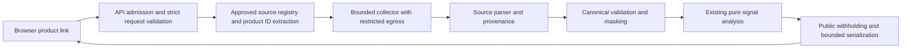

# E03 — Product URL ingestion contract and security design

Date: 2026-10-31. Design version: `rt-product-ingestion-0.1.0-draft`. Status: **DESIGN COMPLETE; NOT IMPLEMENTED OR ENABLED.** The owner explicitly requested E03 while E02 is blocked; this authorizes independent design work, not source permission or live collection. No source is approved. Source-specific field mappings, quotas and rights must be confirmed before activation.

[SPEC.md](../SPEC.md) remains the contract authority and adopts this proposed extension by reference. [THREAT_MODEL.md](THREAT_MODEL.md) records its threats/controls. Existing v1 endpoints, methodology 0.3.0, runtime behavior and frozen research reports remain unchanged. The collector and product endpoint described here do not exist yet.

## Architecture and activation



Start with bounded synchronous processing, one process, two shared analysis slots and no queue, database, background crawler, browser engine or durable job. Collection and computation share admission and a single deadline; async I/O must not block the event loop. Introduce jobs only after measurements show the approved source cannot fit and a separate design covers storage/cancellation/worker limits. Provider access and network restrictions are activation prerequisites, not environment flags a client can bypass.

The registry starts empty. Each reviewed entry binds an internal source ID, exact ASCII HTTPS origin/443, approved product-path grammar, fixed API base/paths and allowed parameters, adapter version, secret reference, field/display rights, quota and expiry/revocation. A different API host requires its own reviewed exact binding. No user-supplied endpoint, source ID, header, secret or page cursor. Rights expiry/revocation disables new collection immediately; the current request checks again before output. Do not add auto-discovery, arbitrary wildcard origins or fallback scraping.

## Proposed public request

Future endpoint: `POST /v2/products/analyze`, `application/json; charset=utf-8`, no compression. Existing /v1 routes remain compatible and never fetch a URL from text or source_id.

```json
{
  "schema_version": "2",
  "product_url": "https://shop.example/product/headphones-example/",
  "category": "electronics",
  "language": "en"
}
```

The .example URL is illustrative and never admitted. Exact keys only; duplicate JSON keys/nonfinite numbers/invalid UTF-8/surrogates/NUL rejected using existing safe-decoding conventions. category/language are the explicit supported-scope declaration, not inferred truth. product_url is a nonempty ASCII string, at most 2,048 characters, with no whitespace/control characters, backslash, userinfo, fragment, query or IP-literal host; HTTPS only, absent port or literal 443, no trailing-dot host. No tracking query stripping or shortlink expansion in the first release. Supported source adapters admit only their reviewed path grammar, reject dot segments, encoded separators/double decoding/ambiguous escapes, and extract a bounded product token. Unknown path/host rejects before DNS. International paths/hosts or query-based variants require a later explicit contract extension, not permissive parsing.

Normalize hostname case once with a standards-aware URL parser, then match the exact registered host. Validate authority and path independently; hostname suffix checks and a URL regex alone are insufficient. Parse once at ingress; pass typed source/product identifiers to downstream functions. Build outbound API paths and query values from trusted templates and encoded bounded tokens. Never forward the original URL, path, query, pagination Link, redirect Location or provider-supplied URL as a request target. Resolve slug-to-ID only through the source's fixed product lookup, returning exactly one match or a safe failure.

## Proposed result

Future envelope `ProductAnalysisResultV2` has exact fields:

| Field | Required meaning |
| --- | --- |
| schema_version | Literal `2` |
| ingestion_version | Exact implemented ingestion version; draft version cannot claim live support |
| source | `{id, adapter_version, retrieved_at, attribution}`; server-assigned ID; ISO UTC completion time and bounded permitted plain-text attribution |
| product | `{ref, title, canonical_url, variant}`; ref is request-local `p1`; permitted masked title max 300 points; registry-generated canonical URL max 2,048; variant null or bounded plain label max 100 |
| collection | Defined coverage object below |
| analysis | Null for empty collection, otherwise v2 analysis object below |

The v2 analysis object retains existing AnalysisResult fields and validation, except schema_version=`2` and origin=`collected`, assigned by the server. Never falsify origin as paste/csv/research to fit existing schemas. E07 must introduce matching typed API/UI contracts and fixtures; pure signal calculations and evidence gates can be reused without accepting public research origin. No method thresholds change here; methodology stays 0.3.0 unless implementation changes its semantics and intentionally versions/snapshots them.

All successful nonempty analysis has score.value=null, reason public_score_not_validated and status withheld/insufficient_evidence; confidence.level=null/status not_validated. Bound the entire envelope to 2,097,152 UTF-8 bytes inside admission, not just its analysis child. No price, image, external HTML, authenticity verdict, alternatives or company rating in this endpoint's first version. Remote links remain registry-generated navigation links; they are not fetched as previews.

Collection object fields:

- status: `complete`, `partial` or `empty`.
- stop_reason: `exhausted`, `row_limit`, `page_limit`, `source_window` or `empty`.
- fetched_records, analyzed_reviews, overlap_records: bounded nonnegative integer counts. fetched_records counts records received across pages, including repeat source IDs. analyzed_reviews equals analysis.review_count; empty requires zero/null. overlap_records counts only identical records repeated by stable source ID during pagination, never equal wording from distinct source reviews.
- available_reviews: null or nonnegative source-reported count, with count_scope=`selected_product` or `unknown`. No fabricated total, fraction or “all reviews” statement when scope/count is unknown.
- pages_fetched: integer 0–5; selection_order: initial literal `newest_first`; variant_scope: `selected_variant`, `combined` or `unknown`; window_started_at/window_finished_at UTC strings describing collection, not review-date span.

complete means the source explicitly indicated exhaustion of the approved selection, not proof that all product reviews exist in the API. partial is only a deliberate bounded selection ending after valid pages; row/page/window stop reasons must be visible. empty means a successfully validated approved selection contains no reviews and yields analysis=null. When exhaustion cannot be proved, return partial/source_window. For 500 rows obtained on the last page without a reliable end marker, return partial/row_limit; no extra request just to claim completion.

Network/auth/schema/byte/deadline failures never return 200 partial analysis. Reject atomically with the safe error envelope, discard collected buffers and keep admission until cleanup completes. Missing optional rating/date values stay null. Source moderation/verified-purchase status is metadata, not ground truth. Different review IDs with the same text remain distinct. Repeated identical source IDs can be collapsed only as documented pagination overlap; a conflicting record for the same ID fails. Keep provider IDs request-local and out of public review refs/logs. Actual source-specific stability and ID behavior must be verified in E02/E06.

For the tentative WooCommerce adapter: process only approved reviews of the resolved product and disclose variant pooling. Product-filtered pagination uses server-built integer page numbers, never follows Link headers. Strip HTML with a reviewed non-executing text parser, then validate/mask; no unsafe React HTML or external-resource fetching. Missing ratings can be null, but a supplied 0 is outside the existing 1–5 contract and rejects as source_data_invalid rather than being coerced or silently dropped. UTC source dates use explicitly documented UTC semantics; never guess a server timezone. Reject malformed supplied optional values rather than removing rows. Invalid records cannot be used as an invisible favorable filter.

## Initial budgets — design ceilings, unmeasured

| Resource | Proposed ceiling |
| --- | --- |
| Public request | 8,192 actual body bytes; product_url max 2,048 ASCII characters |
| Shared analysis admission | Existing two slots for body/collection/CPU/serialization; no waiting work queue |
| Overall deadline | Existing 10 seconds from admitted body read through serialized result; monotonic |
| Collection subdeadline | At most 4 seconds, clipped by remaining overall time, including DNS/TLS/body/parse |
| Per connection/read operation | At most 1 second, clipped by collection deadline; outer deadline stops slow trickles |
| Outbound requests | At most 6 GET attempts (one metadata resolution + up to five review pages); no automatic retries/redirects |
| Pages / page request | At most 5 / at most 100 source records, or a lower approved source cap |
| Fetch concurrency | One request per analysis; global source concurrency at most 2 or lower provider quota |
| Response bytes | At most 262,144 per upstream body and 1,048,576 aggregate across requests, counted while streaming before parse |
| Upstream headers | At most 16,384 bytes and 32 fields per response; reject malformed/duplicate framing headers |
| Upstream format | UTF-8 JSON only, identity content encoding; reject unexpected compression/content types/HTML challenge pages |
| Input to pure analysis | Existing 500 rows, text 5,000/title 300, aggregate 250,000 points before and after normalization/masking |
| Public output | Existing 2 MiB cap applied to whole v2 envelope; no partial streamed results |

E02 may impose stricter quotas; it cannot raise ceilings without review/measurements. Source page sizes are upper requests, not permission to silently slice oversized or invalid pages. A lower approved page size may exhaust page budget before 500 rows: disclose partial/page_limit. No hidden chunking into multiple analyses, row truncation, body decompression, unlimited retry or per-user bypass. Collection limits bound the selected sample; existing canonical row/field/output limits still reject over-limit records atomically.

Use existing peer buckets (burst 2, refill 10/minute) before outbound work, plus a provider-wide quota/cost budget shared by all source callers in the one process. The provider budget/period must come from E02; absent configuration disables collection. Successful, failed and cancelled attempts consume quota. Upstream 429/Retry-After creates a bounded source cooldown, not a server sleep or an auto-retry; expose a safe bounded retry hint. Multi-process/instance or rollout overlap requires verified shared quota/edge enforcement before activation. Memory-only counters can reset on restart and are not durable spending guarantees; provider-native hard caps/alerts are required if access can incur fees.

## Destination and secret controls

1. Fail closed when source registry is empty/disabled, rights are absent/revoked, quotas are missing or transport guarantees cannot be demonstrated. The browser cannot activate a source.
2. Resolve the fixed registered host through a bounded resolver; inspect all returned A/AAAA addresses. Reject no answers, private/loopback/link-local/unspecified/multicast/reserved/special-use, IPv4-mapped bypasses and actual provider/internal/metadata ranges, including globally addressed internal networks. Reject mixed permitted/prohibited answers. A single is_global flag is not the whole deployment policy.
3. Bind each connection to a validated address while preserving original Host, TLS SNI and hostname/certificate verification. Do not validate DNS and then let the client perform an unchecked second lookup. Revalidate each new connection/address, including fallback; reuse only verified same-origin peers. Disable environment proxies, automatic redirects, cookie jars, netrc and ambient auth. No cross-origin credential reuse, HTTP downgrade or certificate bypass.
4. Use outbound network isolation allowing only the reviewed source path/host service and necessary DNS through controlled resolver infrastructure; deny internal/metadata access. Enforce method/path restrictions at the collector boundary; network firewalls alone do not understand HTTPS paths. If native provider/network controls cannot meet this, live collection remains off pending a reviewed solution. No custom generic proxy service is introduced in this step.
5. Source secrets are server-only, narrow Read scope, header-based over HTTPS, revocable, and bound to their registered API origin. Never send them to product navigation URLs. Verify store-user capability scope; a broad Read manager key is not an acceptable default. No keys in URLs, errors, browser bundles, Git or telemetry. No credential discovery from third-party frontend assets.
6. Discard unneeded fields (names, email, avatars, profile/IP/location) on parse; raw network buffers may transiently contain them but must be bounded and promptly released. No disk spool, snapshots, response dumps or provider-body logs. Log only existing fixed safe error codes/random request IDs; never arbitrary exception strings, URLs, slugs, upstream messages or credentials.
7. Provider content is untrusted: no script execution, dynamic browser, unsafe deserialization, prompt/tool execution, HTML injection or external image/media downloads. Mask text before excerpts/signals. Incomplete masking remains disclosed.

The selected client/transport implementation must demonstrate DNS-to-connection binding and bounded headers/timeouts in E05; a library name alone does not establish these guarantees. Synthetic transport tests must not introduce a localhost/private-address escape hatch into the live path.

## Error contract and lifecycle

Reuse the current safe ErrorResponse shape and X-Request-ID/no-store/CSP/nosniff/no-referrer policy. Source errors do not include provider strings, host/IP details or submitted URLs. Validation fields use only canonical names. Existing 400/413/415/422/429/503/500 behavior remains; new mapping:

| Status | Code | Meaning |
| --- | --- | --- |
| 422 | invalid_product_url / unsupported_source / unsupported_product | Invalid grammar, unknown source/path or unsupported category/variant; no network before registry/path validation |
| 503 | source_not_ready | Registered but unapproved/disabled/expired source, missing quota/secret or unavailable required transport policy |
| 403 | source_destination_blocked | Approved host resolves/connects outside allowed destination policy; no address detail |
| 404 | product_not_found | Valid approved lookup yields no product |
| 503 | source_access_unavailable | Upstream auth/access denied; do not forward 401 or imply user login fixes server credentials |
| 503 | source_rate_limited | Provider throttle or source cooldown/quota; bounded Retry-After when meaningful |
| 502 | source_unavailable / source_redirect / source_data_invalid / source_limit | Upstream failure, any redirect, schema/association conflict or upstream header/body/record ceiling; no partial findings |
| 503 | request_timeout / analysis_busy | Existing shared deadline or admission refusal |
| 413 | normalized_text_limit / response_limit | Existing normalized canonical or whole-envelope output cap |

Own peer rate rejection remains 429/rate_limit. Unknown public route stays 404 until implemented; no endpoint or source-not-ready behavior is claimed today. source_limit does not use public-input 413 to blame the visitor for the provider's response.

State machine: validate/admit -> select source -> reserve quota -> fetch/parse valid bounded sample -> canonical validate/mask -> analyze -> withhold public score -> serialize/cap/check deadline -> respond -> cleanup/release. Empty is an explicit valid terminal response. On failure/disconnect, close upstream streams and cancel pending I/O; retain admission for any running CPU worker until completion. Source secrets/buffers remain request-owned; no orphan background fetch. All body reads, DNS and provider calls consume the same overall budget. A client abort only discards browser state; resource cleanup must be independently tested server-side.

## Verification required before declaring implementation safe

E04 can implement only authored adapter/parser fixtures on explicit `next`; this does not satisfy E02. E05 live collection requires E02 permission/access and tested transport/egress. E07/E08 must version consumed contracts together. Tests must cover:

- Rejected schemes, ports, userinfo, backslashes, controls, encoded paths, deceptive suffix hosts, IP encodings, Unicode/IDNA ambiguity, fragments/query/shortlinks, unsupported origins and source disablement before any DNS/socket call.
- IPv4/IPv6/mapped/private/metadata/internal destinations, mixed DNS answers, DNS rebinding, alternate/fallback addresses, peer/TLS mismatch, malicious redirects and environment proxies. Assert zero credentials sent to rejected hosts. Actual restricted-egress verification is separate from mocks.
- Source fields/IDs/variants, HTML and Unicode text, null versus invalid metadata, zero rating, PII stripping, duplicate source-ID overlap/conflict, repeated text from different reviews, stable page ordering and source totals/window ambiguity.
- Shared deadlines, slow headers/bodies, byte caps without Content-Length, compressed responses, provider auth/429/quota failures, exactly exhausted page/row budgets, disconnects and retained worker slots. No partial results on errors.
- v2 envelope/UI rejection of old/forged numeric outputs, no raw URLs in error/logs, bounded envelope serialization, no credential/browser persistence and responsive accessible source/coverage display. Preserve all existing v1 regressions and source-bound reports intentionally.

Design follows the allowlisting, redirect, connection-time DNS and network-layer principles in the [OWASP SSRF Prevention Cheat Sheet](https://cheatsheetseries.owasp.org/cheatsheets/Server_Side_Request_Forgery_Prevention_Cheat_Sheet.html), read 2026-10-31. These budgets and v2 choices are project design decisions, not OWASP-prescribed values or verified source capacity. Current E03 checks cover document consistency only; none of the future network controls or test cases is claimed implemented.


## E04 implementation checkpoint

The offline product/page parser and authored fixtures are implemented as documented in [SOURCE_PARSER.md](SOURCE_PARSER.md). This is one internal component of the design; the endpoint, registry, collector, proposed v2 public contract and network controls remain unimplemented. No source is admitted. E04's stricter within-page duplicate-ID rejection is explicit; cross-page overlap handling remains E06. Original budget hypotheses require later integrated verification.


## E05 partial implementation checkpoint

[Offline safeguards](SOURCE_COLLECTION.md) now implement a subset of the planned policy/accounting. Registry remains empty, no network transport or HTTP integration exists, and source access/egress evidence is absent. The budgets/error mappings above are still future integrated acceptance requirements. E05 is BLOCKED, not complete; E06 has not begun.


## E05 transport continuation

[SOURCE_TRANSPORT.md](SOURCE_TRANSPORT.md) records an unwired bounded metadata transport built with existing AnyIO/h11 and tested with synthetic streams. Numeric peer/TLS-host configuration, pre-auth socket-peer checks, bounded raw header/HTTP reads, actual I/O timeouts and owned-stream cleanup are now implemented as internal components. A stricter per-exchange raw wire cap of 278,528 bytes includes chunk framing overhead. No bounded resolver, source registry activation, egress/provider proof or serving integration is supplied. E02/full E05 remain BLOCKED; E06 is not started. This is not a functional public URL analyzer.


## E06 independent fixture checkpoint

E06 owner override (2026-10-31): owner explicitly authorized authored synthetic fixtures only while keeping live collection blocked. Offline sample assembly is COMPLETE in api/app/source_sample.py; see [SOURCE_SAMPLE.md](SOURCE_SAMPLE.md). E02/E05 live gates remain BLOCKED; E07 is pending and no source, endpoint or URL UI is enabled. SourceSample is an internal authored_fixture record, never a v1 submission with a forged origin or a public v2 response. Earlier E06-not-started statements are historical.

The explicit exhaustion marker is authored input, not verified provider evidence. A short page never proves exhaustion. No pagination requests are made; byte/page buffers are assembled offline. Network errors cannot be supplied as a successful partial page. E07 must preserve the distinct v2 origin and null-analysis empty contract when it is implemented.


E07 ingress checkpoint (2026-10-31): POST /v2/products/analyze is implemented fail-closed with strict typed request validation, 8 KiB actual-body limit and shared v1 rate/admission/deadline/worker controls. No success analysis path, fixture loader, collector or source activation is wired. E07 remains PARTIAL/BLOCKED for full integration; E02/E05 live gates remain blocked, E08 pending. See PRODUCT_API.md. Earlier no-product-endpoint statements are historical.


E07 fixture-analysis continuation (2026-10-31): api/app/fixture_analysis.py now validates/serializes authored-fixture schema-v2 analysis with explicit authored_fixture origin/declaration, null public score/confidence, collection counters/windows/order, masked bounded product title and null analysis for zero reviews. Existing analyzer field calculations are shared by a small analyze_fields extraction; v1 still validates AnalysisResult and accepts only paste/csv input. No production route loads fixtures or returns success. E07 remains PARTIAL for production collected-origin contracts/integration; E02/E05 live gates blocked, E08 pending. Seven authored cases include a test-only admitted HTTP route, not a production success claim. No new dependency, source, model or deployment.
